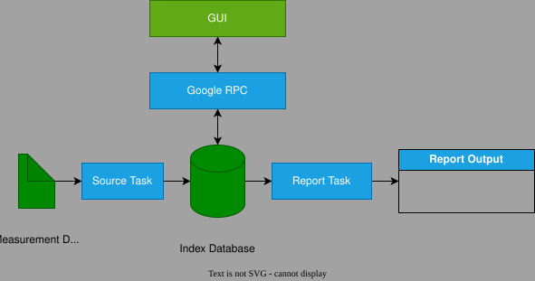

# Report Server

## Summary

The report server stores measurement data files information in an ASAM ODS based database. 
The database is an index database as it only stores information about a file not its raw sample data.
The purpose of the database is to speed the up search of test and measurements in applications
that have many data files.

  

The server have support of the ASAM MDF data files. 
This format is the best file for long-term storage and is standard file format within the automotive industry.

The project specification is in [Functional Specification](specification/report_server.docx).

### State of Project

The project is under reconstruction. 
It is current inside the ODS library repository but will be moved to this repository.
It is possible to build the project from scratch but there are many external libraries to include.
Recommend to use the pre-built executables instead.

## Index Database

The database is based upon the ASAM ODS standard.
The database do not stored the raw data samples.
Instead it stores the file information.

* Measurements and its Quantities for each file.
* Test Object Data.
* Relation to configuration files as DBC or A2L files.
* Measurements with a single sample. 

Simple databases uses the SQLite database while servers that operates 24/7 
should use relational databases as Postgres or MS SQL server.

## Input Sources

The server have one or more input source tasks.
A source task shall detect new and deleted remote files,
parse the information and update the database with that information.

A source task can also copy or move the remote files to a local storage.
Note that a input source typically is end-user specific.

## Generating Reports

When a new file is inserted into the database, this may trigger a so-called report task.
Internally this is a destination (sink) task.
A report task is a abstract task that is started manually or automatically.
A report first generate a selection list and then generate some output result.

### Selection List

A selection list is a list of measurement quantities.
The list is generated by using the database without reading any files.
The list may contain selections from many files.

Generating a selection list is fast while creating the output result, 
requires that all selected files sample data are read. 
The latter may take some time.

### Data Lake

The report server can be used as Data Lake application 
but note that the fetching of sample data is done by reading the
original files. 
This may be to slow for some end-user applications.
In those cases, this server is mainly used for long-term storage.

## GUI Front-Ends

The report sever can either be used 24/7 or launched by a GUI application.
The basic server is actually a library C++ class. 
This library can be launched by a GUI application, or a Google RPC server. 

### Report Explorer GUI

This GUI starts a report server at start. 
The server first search for new files and then for deleted files.
The server does only read the file information and update the local SQLite database.
It do not support automatic generation of reports, so all reports are generated manually.
The application should be used within a test bed or similar.

## License

The project uses the MIT license. See external LICENSE file in project root.

